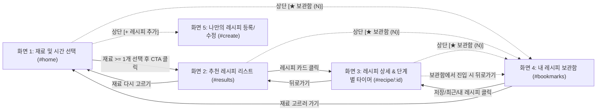

# 냉장고 털이 한 끼 (`foodinfridge`) 구현 계획서 (PLAN)

## 1. 목표 및 기술 스택 전략

`PRD.md`의 **「냉장고 털이 한 끼」** 기획과 `DESIGN-claude.md`의 **웜 크림·코랄 에디토리얼 디자인 시스템**을 결합하여, 별도 회원가입이나 서버 없이 즉시 실행되고 Vercel 정적 배포까지 바로 가능한 반응형 웹서비스를 구축합니다.

- **핵심 사용자 경험:** 앱 설치·회원가입에 지친 2030 1인 가구가 냉장고 속 자투리 재료(최소 1개, 최대 제한 없음)와 조리 가능 시간(`10분 / 20분 / 30분`)을 선택하면, 보유 재료 소진 효율이 가장 높은 초간단 레시피를 추천받고 주방 타이머로 바로 조리한 뒤 브라우저 보관함(`localStorage`)에 저장해 재활용합니다.
- **기술 스택 전략:** 외부 의존성이나 복잡한 빌드 없이 즉시 실행·배포 가능한 **순수 정적 웹서비스(HTML5 + CSS Custom Properties + Vanilla JS)**로 구성하며, 전역 네임스페이스(`window.FridgeMeal`) 기반 모듈 분리로 로컬 및 Vercel HTTPS 환경 모두에서 안정적으로 동작하게 합니다.

---

## 2. 화면 흐름 및 아키텍처



### 디렉터리 구조

```text
foodinfridge/
├── index.html                           # 시맨틱 앱 셸, 폰트 프리로드, 파비콘·푸터 로고
├── vercel.json                          # Vercel 정적 호스팅 설정
├── assets/
│   ├── fonts/OngleipParkdahyun.ttf      # 온글잎 박다현체 전역 폰트
│   └── images/
│       ├── hero-logo.png                # 투명 배경 히어로 일러스트 로고
│       └── home-preview.png             # README 첫 화면 프리뷰 이미지
├── css/
│   ├── tokens.css                       # 컬러·타이포그래피·간격·반경 디자인 토큰
│   ├── base.css                         # 리셋, 루트 20px 타이포 계층, 반응형 레이아웃
│   └── components.css                   # 전 화면 UI 컴포넌트 스타일
└── js/
    ├── data/
    │   ├── ingredients.js               # 기본 21종 재료(5개 탭) 및 조리 시간 옵션
    │   └── recipes.js                   # 내장 32종 초간단 레시피 (쉬운 계량·상세 손질)
    ├── core/
    │   ├── matching.js                  # 4단계 규칙 기반 추천 정렬 및 0건 시간 해제 Fallback
    │   ├── storage.js                   # localStorage 4종 저장소 & 글자 수·무결성 방어
    │   └── kitchenApi.js                # Web Audio 3회 반복 알림, 진동, Screen Wake Lock
    └── app.js                           # 5개 화면 렌더링, URL 해시 라우팅, 드리프트 방지 타이머
```

---

## 3. 단계별 구현 계획

### Phase 1. MVP 핵심 기능 & 디자인 시스템 구축
1. **디자인 토큰 및 레이아웃 (`css/`):** 웜 크림 캔버스(`#faf9f5`), 크림 카드(`#efe9de`), 웜 코랄 강조(`#cc785c` / `#fae0d2` / `#f4cdb8`) 팔레트와 모바일 퍼스트(2열) → 데스크톱(4열) 반응형 그리드 구현
2. **데이터 레이어 (`js/data/`):** 기본 양념 4종(`소금·설탕·간장·식용유`) 전제의 자취 재료 및 초간단 레시피 풀 구축 (`T/t` 제거 → `밥숟가락·티스푼·종이컵` 쉬운 계량 + cm 손질 가이드)
3. **추천 매칭 엔진 (`js/core/matching.js`):**
   - `matchCount >= 1 && cookTime <= maxCookTime` 필터링 (0건 시 시간 제한 자동 해제 Fallback 배너)
   - 4단계 정렬: ① 일치 재료 내림차순 → ② 추가 필요 재료 오름차순 → ③ **보관함(`★`) 저장 우선** → ④ 조리 시간 오름차순
4. **주방 특화 타이머 & API (`js/core/kitchenApi.js`, `js/app.js`):**
   - `Date.now()` 델타 기반 드리프트 방지 카운트다운, 56px 이상 터치 버튼
   - 종료 시 Web Audio 3회 반복 차임음 + 진동 + `[알림 끄기]` 배너, 실행 중 이탈 방지 경고, `Screen Wake Lock API`

### Phase 2. 사용자 맞춤 확장 & 브랜딩 고도화 (v1.2)
1. **사용자 재료 & 나만의 레시피 통합:**
   - 그리드 끝 `[재료 추가]` 카드로 26종 아이콘과 함께 재료 등록, `✎` 인라인 수정(화면 이동 없이 이름·카테고리·아이콘 변경 + 레시피 주재료 자동 동기화), `×` 삭제
   - 나만의 레시피 등록·수정·삭제 및 직접 입력 재료의 홈 `기타` 탭 자동 통합
   - `모두 선택` / `선택 초기화`, 레시피 하단 `[✓ 요리 완료]` + 보관함 최근 만든 레시피 최대 3개(FIFO) 기록
2. **브랜딩 및 입력 안정성 강화:**
   - `온글잎 박다현체` 확대 폰트(`20px`), 대파 전용 SVG·주황빛 김치 이모지·히어로 투명 일러스트 로고 적용
   - 전 입력 필드 `maxlength` + 실시간 글자 수 카운터 + CSS `overflow-wrap: anywhere`로 긴 문자열 카드 넘침 원천 차단

### Phase 3. 배포 및 자동화 QA 검증
1. **배포:** GitHub `main` 브랜치와 Vercel 연동 (`https://foodinfridge.vercel.app`)
2. **검증:** `QA.md` 32개 정상·예외 시나리오 기준 Playwright 자동화 전수 테스트 실행 → 1차 QA에서 발견된 `navigator.vibrate(0)` 콘솔 경고 수정 후 2차 재검증 **32 / 32 PASS · 콘솔 에러 0건** 확인 (`QA_REPORT.md`)
