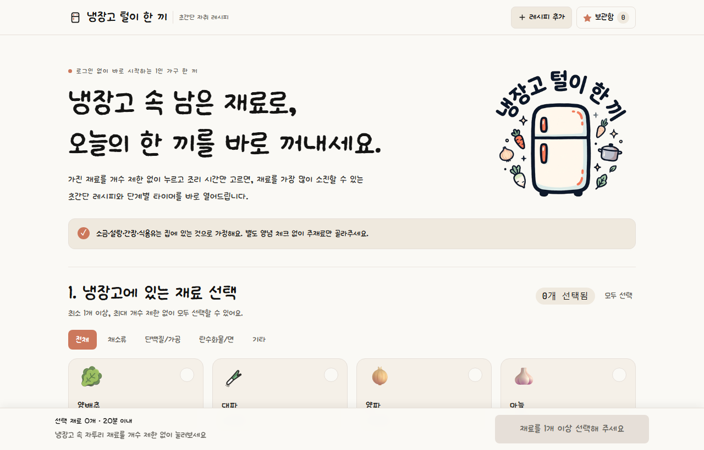

# 냉장고 털이 한 끼 (`foodinfridge`)

## 한 문장 소개
번거로운 앱 설치와 회원가입에 지친 2030 1인 가구가 남은 식재료 활용법을 몰라 배달 음식을 시키게 되는 문제를 해결하기 위해, 웹에서 보유 재료만 체크하고 추천순 정렬을 확인하면 맞춤형 한 끼 레시피와 북마크 기능을 즉시 활용하는 서비스입니다.

---

## 배포 주소
👉 **https://foodinfridge.vercel.app**  
*(로그인·앱 설치 없이 모바일·PC 웹 브라우저에서 바로 사용할 수 있습니다.)*

---

## 사용 방법
1. **재료·시간 고르기:** 냉장고에 남아 있는 재료를 개수 제한 없이 선택하고(없는 재료는 직접 추가·수정 가능), 조리 가능 시간(`10분 / 20분 / 30분 이내`)을 고릅니다.
2. **추천 레시피 찾기:** 하단 버튼을 누르면 보유 재료가 가장 많이 겹치고 추가 재료가 적은 순(보관함 `★` 저장 레시피 우선)으로 정렬된 맞춤 레시피를 바로 확인합니다.
3. **요리하고 보관하기:** `밥숟가락·티스푼·종이컵` 쉬운 계량과 단계별 타이머로 한 끼를 완성하고, 마음에 든 레시피는 보관함(`★`) 북마크와 나만의 레시피로 저장해 다시 꺼내 씁니다.

---

## 화면

---

## 만든 과정
- 📋 **[PRD.md](./PRD.md)** — 서비스 기획, 타깃 페르소나, 4단계 추천 정렬 로직, 기능 요구사항 및 v1.2 최종 명세
- 🗺️ **[PLAN.md](./PLAN.md)** — 기술 스택 전략, 화면 흐름·아키텍처 설계 및 단계별 구현 계획
- 🎨 **[DESIGN.md](./DESIGN.md)** — 웜 크림·코랄 컬러 시스템 및 타이포그래피·컴포넌트 디자인 기준
- 🧪 **[QA.md](./QA.md)** — 전체 기능 정리(`F1~F8`) 및 정상·예외 케이스 32종 QA 시나리오
- ✅ **[QA_REPORT.md](./QA_REPORT.md)** — 라이브 배포 환경 대상 Playwright 자동 QA 실행 결과 리포트 (`32 / 32 PASS`, 콘솔 에러 `0건`)

---

## AI 활용 명세

### 어떤 도구를 어디에 썼는지
| 도구 | 활용 영역 |
| :--- | :--- |
| **Google Antigravity (Gemini 에이전트)** | `PRD.md` 기반 정적 웹앱(`HTML / CSS / Vanilla JS`) 설계·구현, 32종 자취 레시피 데이터 및 매칭·타이머·`localStorage` 로직 작성, 커스텀 SVG·히어로 로고 에셋 가공, `QA.md` 시나리오 수립 및 Playwright 자동 검증 |
| **GitHub & Vercel** | 코드 버전 관리 및 `main` 브랜치 푸시 기반 프로덕션 자동 배포 |

### 무엇을 내가 직접 결정했는지
- **문제 정의와 핵심 경험 설계:** 회원가입·앱 설치 장벽을 없애고, 기본 양념 4종(`소금·설탕·간장·식용유`)을 전제로 주재료 선택부터 타이머 조리까지 최소 터치로 이어지도록 기획
- **기능 범위 취사선택:** 사진 기반 AI 식재료 인식 기능은 실사용 단순성을 해친다고 판단해 과감히 제외하고, 빠른 재료 일괄 선택(`모두 선택`)·커스텀 재료 인라인 추가/수정·나만의 레시피 통합 등 핵심 편의성에 집중
- **디자인·브랜딩 확정:** 웜 크림 + 고채도 코랄-살구 톤, `온글잎 박다현체` 확대 폰트(`20px`), 대파·김치·참치캔·재료 추가 버튼 아이콘 시안 선정 및 테두리 없는 히어로 일러스트 로고 배치 직접 결정
- **자취생 맞춤 콘텐츠·정책 기준:** `T/t` 표기 제거(`밥숟가락·티스푼·종이컵` + cm 손질 가이드), 실제 자취 재료 구성(`마늘` 추가, `우동사리` 제외, `라면` 통일), 보관함(`★`) 우선 정렬 및 최근 만든 레시피 3개 기록 정책 확정
- **품질 검증 기준:** 32개 정상·예외 QA 항목과 글자 수·오버플로우 방어 기준을 검수하고, 1차 QA에서 발견된 콘솔 경고 수정까지 확인 후 최종 배포 결정

---

> **폰트 출처:** 본 서비스에는 (주)보이저엑스 및 박다현 님이 제공하는 무료 폰트 **온글잎 박다현체**가 적용되어 있습니다.
